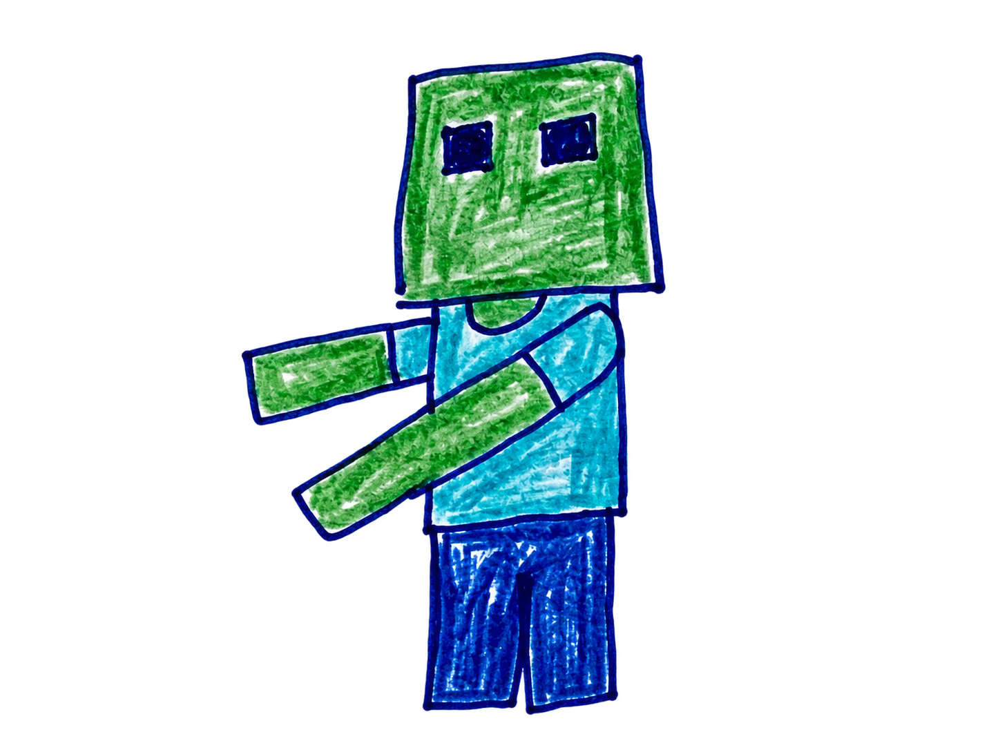
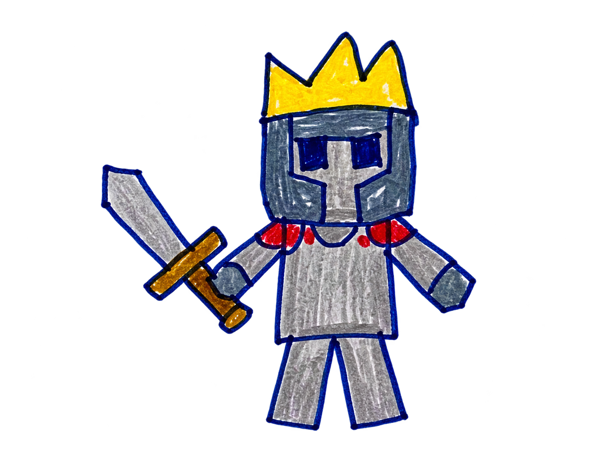
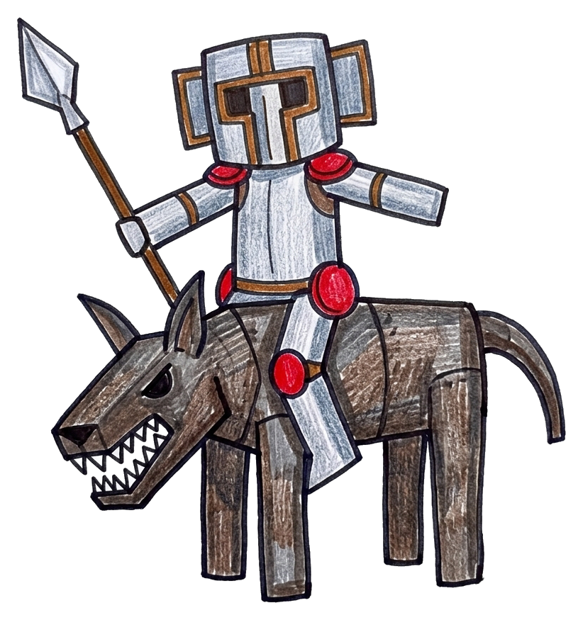
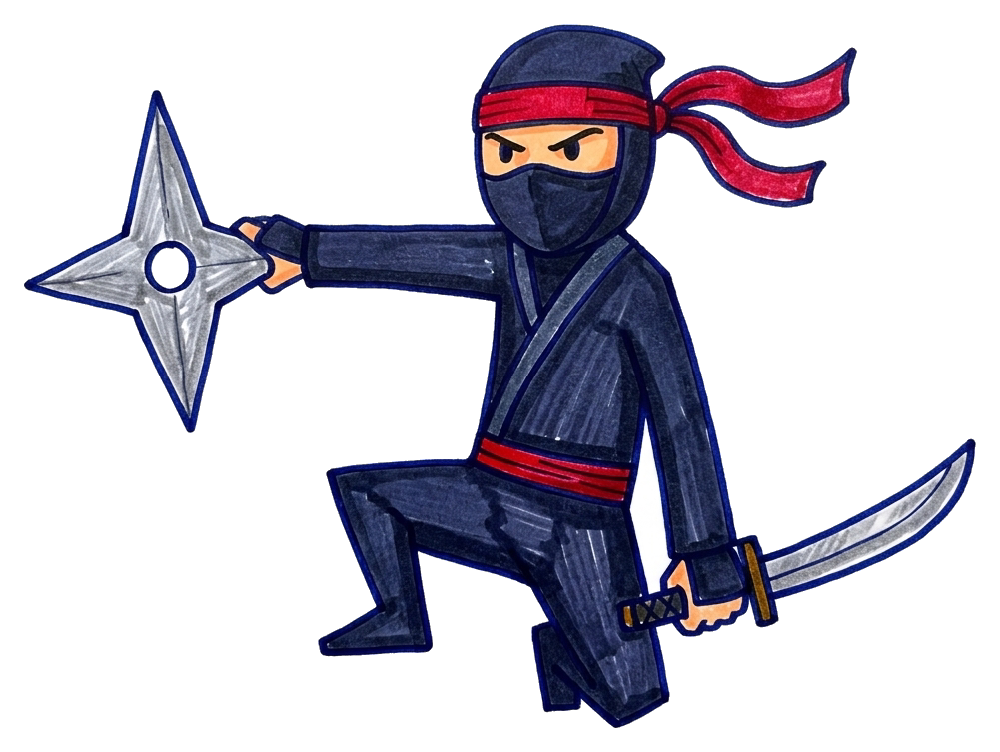
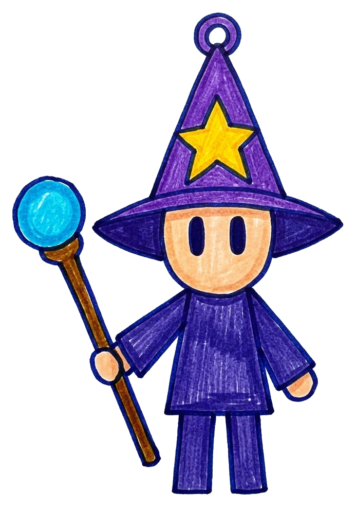
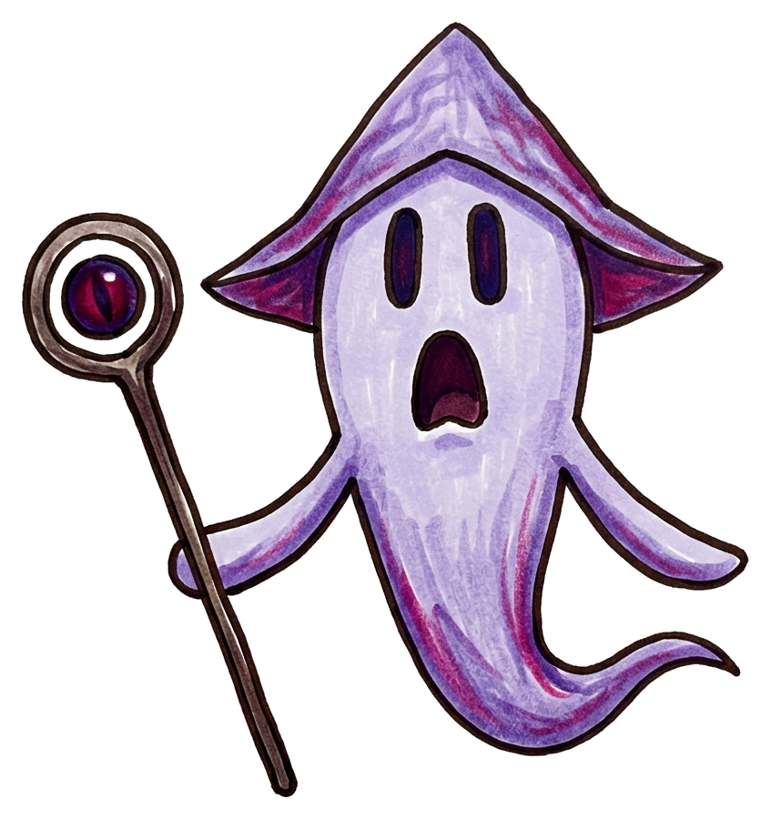
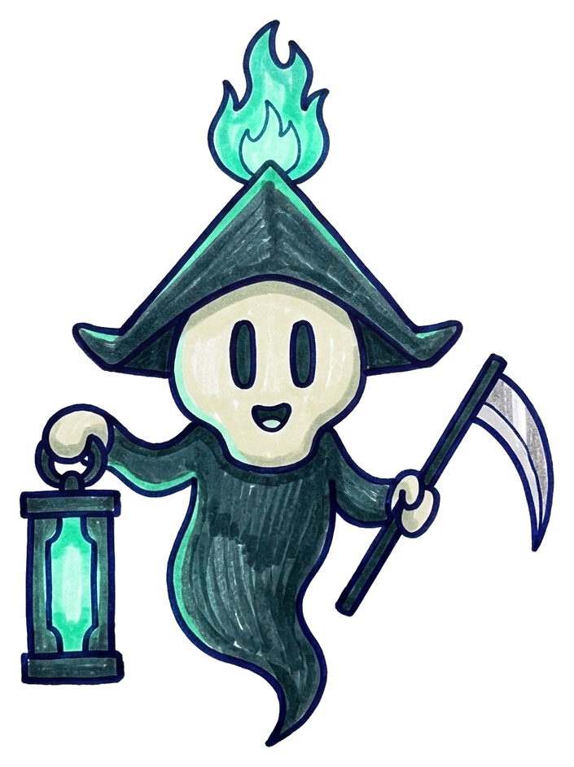
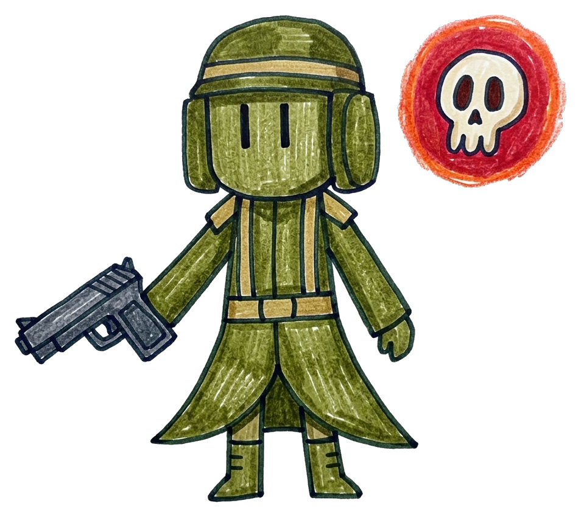
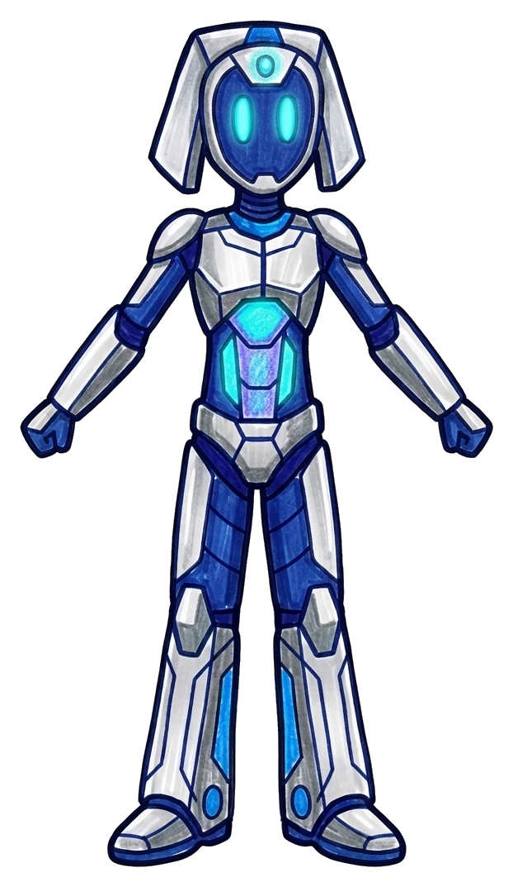
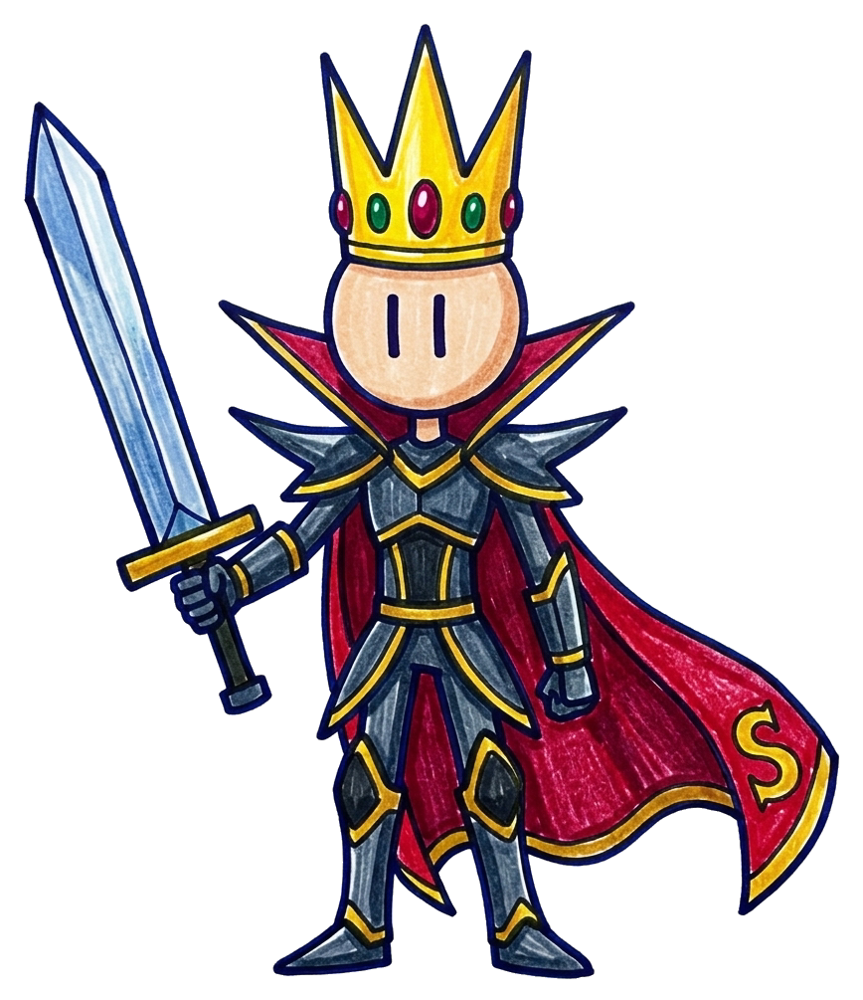

# 怪物素材表

怪物素材由手繪原稿拆分、上色並去背而成，保留原本的手繪線條、蠟筆/麥克筆質感與造型，並整理成透明背景 PNG。遊戲內可直接使用 `final/` 內的圖片。

| ID | 圖片 | 怪物名稱 | HP | 攻擊力 (⚔️) | 擊敗獎勵 | 備註 |
| --- | --- | --- | ---: | ---: | ---: | --- |
| `monster_01` |  | 方塊殭屍 (Square Zombie) | 20 | 10 | 10 金幣 | 手繪方塊人型，向前伸展雙臂 |
| `monster_02` |  | 冠帽小戰士 (Little Knight) | 60 | 20 | 50 金幣 | 戴著三刺皇冠，手持長劍的小戰士 |
| `monster_03` |  | 裝甲騎兵 (Armored Cavalry) | 100 | 25 | 80 金幣 | 身穿鎧甲與頭盔、手持菱形長槍，騎乘裝甲猛獸的騎兵 |
| `monster_04` |  | 忍者 (Ninja) | 150 | 35 | 120 金幣 | 蒙面綁頭帶，右手持大型風魔手裡劍、左手持忍刀的敏捷忍者 |
| `monster_05` |  | 魔法師 (Mage) | 195 | 40 / 30 / 45 | 160 金幣 | 頭戴星紋尖頂巫師帽、手持寶珠法杖；具備魔法球(40)、隕石火球(30)、閃電(45)三種攻擊 |
| `monster_06` |  | 惡魔靈 (Demon Spirit) | 250 | 50 | 200 金幣 | 尖角兜帽幽靈形態，雙臂展開並手持魔眼法杖的惡魔靈體 |
| `monster_07` |  | 死神 (Grim Reaper) | 300 | 75 | 250 金幣 | 頭頂燃燒靈魂火焰的死神兜帽，右手持靈魂燈器、左手持巨型鐮刀 |
| `monster_08` |  | 手槍兵 (Pistol Soldier) | 500 | 125 | 400 金幣 | 頭戴鋼盔與披風長袍，單手舉槍射擊，身旁伴隨骷髏標記光環 |
| `monster_09` |  | AI-Gemini | 750 | 150 | 600 金幣 | 配備頭頂感測晶體與幾何機甲護具的高科技人形機器人 |
| `monster_10` |  | 刀之首領 (Blade Boss) | 1000 | 175 | 800 金幣 | 頭戴寶石三刺皇冠、身披印有 S 標誌的立領披風，手持巨型大刀的終極首領 |

## 資料夾

- `final/`：拆分、上色並去背後的透明背景遊戲素材（PNG）。
- `source-crops/`：從手繪怪物設定稿裁切出的各怪物原始手繪參考圖。
- `source/monsters-combined.jpeg`：第一批雙怪物合併手繪原圖。
- `source/monsters-sheet-02.png`：第二批 8 隻新怪物手繪設定原圖。
- `monsters.json`：程式可讀取的怪物資料（HP、攻擊力、獎勵金幣與素材檔名）。
