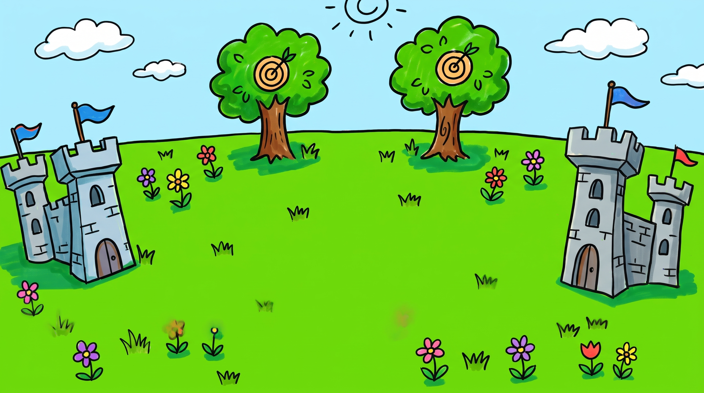

# 戰鬥場景

## 主場景

- 檔案：`battlefield_background.jpeg`
- 尺寸：2752 × 1536
- 建議用途：主戰鬥場景背景
- 畫面中央保留作為角色、怪物與戰鬥特效的主要活動區域。

## 操作方式

第一版網頁遊戲使用以下核心操作：

| 操作 | 電腦操作 | 畫面按鈕／位置 | 用途 |
| --- | --- | --- | --- |
| 移動 | 方向鍵 | 左下虛擬搖桿 | 控制主角上下左右移動 |
| 普通攻擊 | `Space` | 右下大型攻擊鍵 | 固定朝右攻擊；按住可連續攻擊 |
| 暫停 | `Esc` | 右上暫停鍵 | 暫停、繼續或重新開始目前關卡 |

## HUD

| 位置 | 顯示內容 |
| --- | --- |
| 左上 | 已消滅怪物數／總怪物數 |
| 上方中央 | 關卡與怪物生成進度 |
| 右上 | 金幣數與暫停按鈕 |
| 下方中央 | 目前裝備武器 |
| 左下 | 行動版移動搖桿 |
| 右下 | 可按住的攻擊按鈕 |

桌面版使用方向鍵與 `Space`；手機和平板使用左下虛擬搖桿與右下攻擊按鈕，並支援同時移動與攻擊。第一版不加入自由瞄準、閃避或戰鬥中的武器切換。
