# 武器素材表

這組素材以原始手繪稿為造型依據，保留手繪線條與麥克筆／蠟筆上色質感，並整理成透明背景 PNG。遊戲內可直接使用 `final/` 內的圖片。

| 編號 | 圖片 | 武器名稱 | 購買金額 | 攻擊力 | 戰鬥定位與說明 |
| ---: | --- | --- | ---: | ---: | --- |
| 1 | 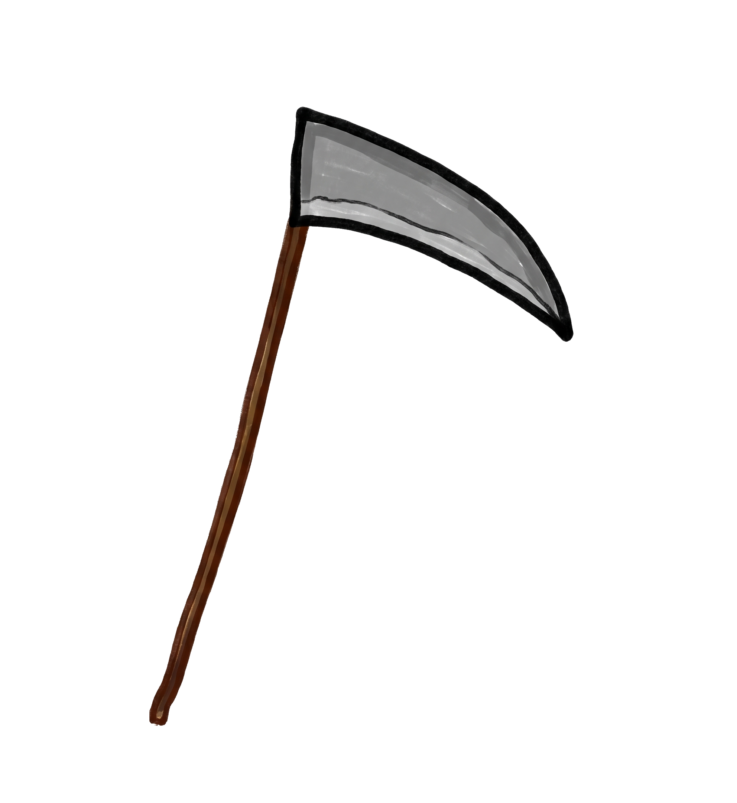 | 鐮刀 | $50 | 8 | 大範圍近戰橫掃（間隔 0.45s） |
| 2 | 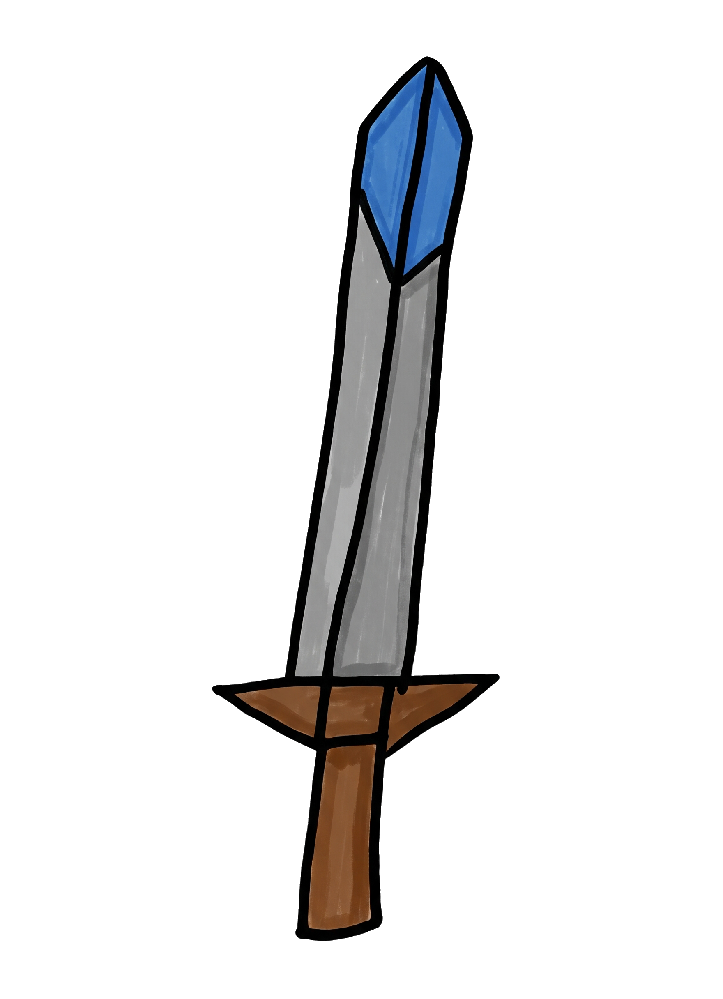 | 長刀 | $100 | 9 | 高速長距近戰斬擊（間隔 0.38s） |
| 3 | 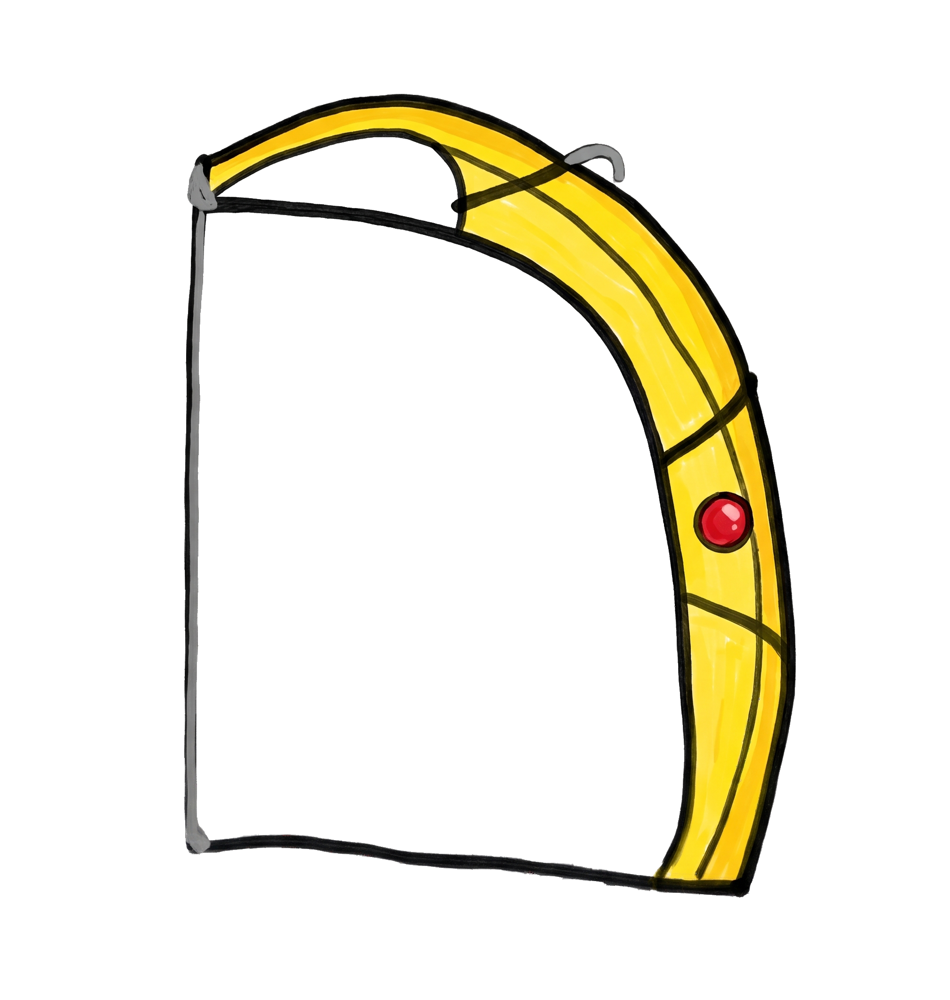 | 弓 | $250 | 8 | 遠程直線穿透射擊（間隔 0.40s） |
| 4 | 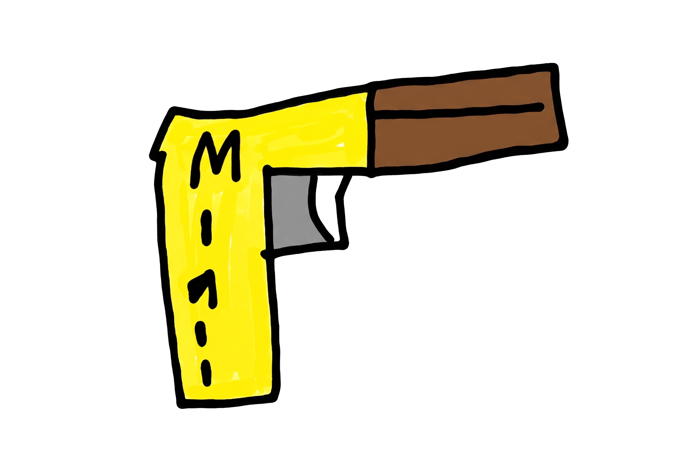 | M1911 | $550 | 10 | 半自動快速穿透手槍（間隔 0.30s） |
| 5 | 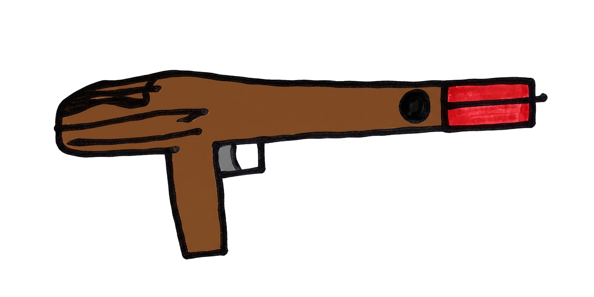 | GL06 | $900 | 20 | 榴彈範圍爆破＋減速（間隔 1.00s） |
| 6 | 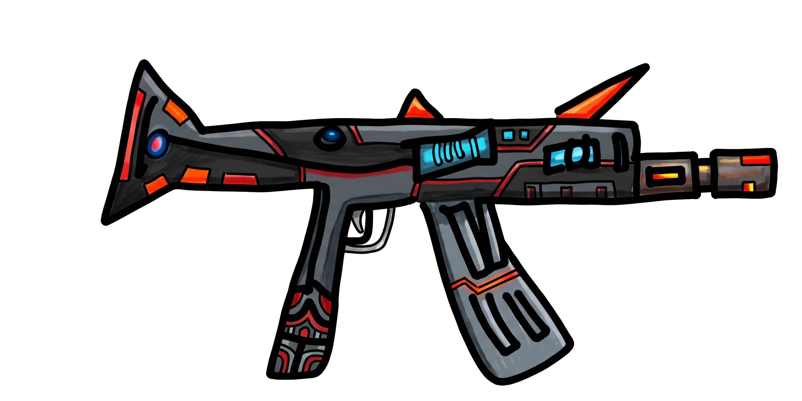 | AK-47 | $1,500 | 15 | 全自動連射穿透步槍（間隔 0.22s） |
| 7 | 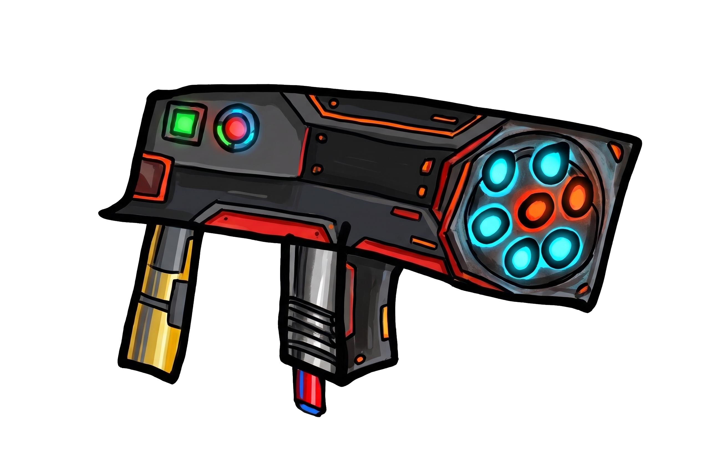 | M134 | $2,000 | 25 | 重型火神機槍彈幕穿透（間隔 0.14s） |
| 8 | 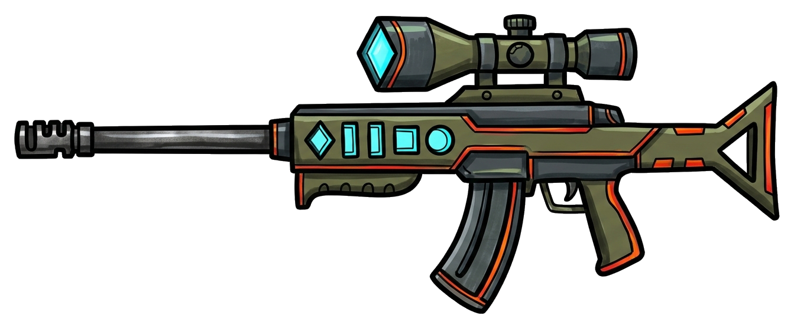 | AWM | $2,800 | 75 | 重型狙擊步槍，高傷直線貫穿＋擊退（間隔 0.36s） |
| 9 | 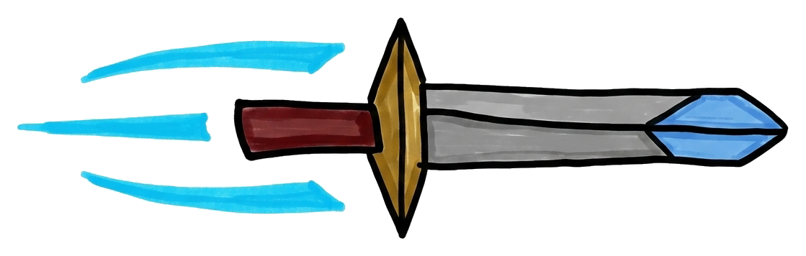 | 飛刀 | $3,500 | 60 | 疾風連擲飛刀，超高速寬幅直線穿透（間隔 0.22s） |
| 10 | 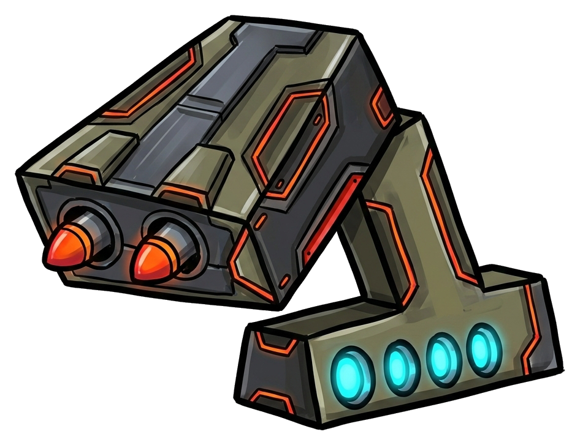 | 愛國者 | $5,000 | 160 | 雙聯裝愛國者飛彈系統，超大範圍高爆轟炸＋強效減速（間隔 0.52s） |
| 11 | 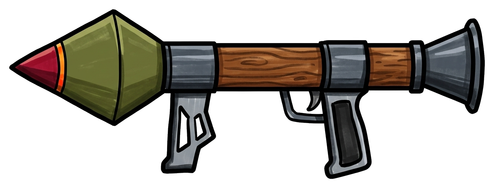 | RPG | $4,200 | 115 | 反裝甲火箭筒，大範圍高爆轟炸＋震退減速（間隔 0.48s） |

## 資料夾

- `final/`：去除紙張、文字與雜線後的透明背景遊戲素材。
- `source-crops/`：從原始照片裁出的手繪造型參考，方便日後比對與重製。
- `weapons.json`：程式可讀取的武器資料與素材路徑。

攻擊力與購買金額已依據 8 關戰役的怪物血量（20 ～ 1000 HP）與金幣產出曲線完成平衡調整，程式資料使用 `attackPower` 欄位。
